# Quantitative Trial Decisions for Means and Rates with rpact

## Introduction

A development decision often depends on two questions: is the treatment
effect sufficiently promising relative to a minimum acceptable
difference, and could it reach a target difference? Quantitative trial
design (QTD) makes these requirements explicit and calculates the
probabilities of the resulting decisions under specified trial
assumptions.

This vignette demonstrates the QTD functions in
[rpact](https://www.rpact.org) for two independent groups with
**continuous endpoints (Means)** and **binary endpoints (Rates)**. Rates
here are event probabilities, rather than event counts per unit of
exposure. We define a decision rule, inspect its output, calculate
operating characteristics, and illustrate every QTD plot type, including
sensitivity and weighted decision-performance displays.

The examples in this vignette were inspired by a presentation by Björn
Bornkamp and David Ohlssen on quantitative trial design. The worked
example uses the fictional project name **Kestrel**. All decision rules,
planning assumptions, and numerical results needed to follow the
examples are provided below.

The examples require the [QTD development version of
rpact](https://github.com/rpact-com/rpact/tree/dev/qtd) providing
[`getDesignQuantitative()`](https://docs.rpact.org/qtd/reference/getDesignQuantitative.md),
[`getOperatingCharcteristicsMeans()`](https://docs.rpact.org/qtd/reference/getOperatingCharcteristicsMeans.md),
and
[`getOperatingCharcteristicsRates()`](https://docs.rpact.org/qtd/reference/getOperatingCharcteristicsRates.md),
together with their QTD print, summary, and plot methods. The spelling
`Charcteristics` follows the current function names.

### How to install the QTD development version

``` r

pak::pkg_install("rpact-com/rpact@dev/qtd", upgrade = TRUE)
```

## Defining a Quantitative Decision Rule

### Reference values and percentiles

| Argument | Interpretation | Default |
|:---|:---|:---|
| `targetValue` | Target value (TV), also called target difference (TD) | Required |
| `lowerReferenceValue` | Lower reference value (LRV), also called minimum acceptable difference (MAD) | Required |
| `lowerPercentile` | Percentile defining the lower interval limit | `0.2` |
| `upperPercentile` | Percentile defining the upper interval limit | `0.9` |

Use reference values on a scale on which larger effects are beneficial,
with LRV no larger than TV. The percentiles satisfy
$`0 < p_L < p_U < 1`$. For a normally approximated effect estimate
$`\widehat\theta`$ with standard error $`s`$, the limits are

``` math
L = \widehat\theta + \Phi^{-1}(p_L)s,
\qquad
U = \widehat\theta + \Phi^{-1}(p_U)s.
```

These are percentile-specific frequentist bounds. The 20th and 90th
percentiles do not describe a symmetric 90% confidence interval and are
not posterior quantiles.

``` r

binaryRule <- getDesignQuantitative(
    targetValue = 0,
    lowerReferenceValue = -0.05,
    lowerPercentile = 0.2,
    upperPercentile = 0.9
)
print(binaryRule)
```

**Design parameters and output of quantitative trial design (decision
rule)**

**User defined parameters**

- *Target value*: 0
- *Lower reference value*: -0.05

**Default parameters**

- *Upper percentile*: 0.9000
- *Lower percentile*: 0.2000

``` r

summary(binaryRule)
```

**Quantitative trial design (decision rule)**

Fixed quantitative trial decision rule.

- *Target value*: 0
- *Lower reference value*: -0.050
- *Upper percentile*: 0.9000
- *Lower percentile*: 0.2000

For a harmful binary outcome we will use $`\theta = p_C - p_T`$. Thus,
LRV = $`-0.05`$ allows an increase of up to five percentage points in
the treatment event probability, and TV = $`0`$ represents equal event
probabilities.

### Three and six decision categories

The main criteria are $`L \geq \mathrm{LRV}`$ and
$`U \geq \mathrm{TV}`$. Meeting both gives **Go**, meeting one gives
**Indeterminate**, and meeting neither gives **Stop**. The six-category
view distinguishes particularly strong evidence and the two reasons for
an indeterminate decision.

| Six-category decision | Interval configuration | Three-category decision |
|:---|:---|:---|
| Go (Fixed) | $`L \geq \mathrm{TV}`$ | Go |
| Go | $`\mathrm{LRV} \leq L < \mathrm{TV}`$ and $`U \geq \mathrm{TV}`$ | Go |
| Indeterminate 1 | $`L < \mathrm{LRV}`$ and $`U \geq \mathrm{TV}`$ | Indeterminate |
| Indeterminate 2 | $`L \geq \mathrm{LRV}`$ and $`U < \mathrm{TV}`$ | Indeterminate |
|  | Stop | $`L < \mathrm{LRV}`$ and $`\mathrm{LRV} \leq U < \mathrm{TV}`$ |
| Stop (Fixed) | $`U < \mathrm{LRV}`$ | Stop |

The implementation includes equality at the corresponding reference
boundary as shown above. This matters for discrete data. “Fixed”
identifies the extreme decision categories. How a team acts on the
middle categories can also depend on the competitive situation and other
evidence.

Calculations retain six exclusive category probabilities. `plotCat = 3`
adds the two Go, the two Indeterminate, and the two Stop probabilities
for display; `plotCat = 6` shows them separately. Rule plots default to
six categories and OC plots to three.

## The Kestrel Binary-Endpoint Example

### Clinical setting and exact input assumptions

Consider a phase II study in de novo renal transplant recipients
involving sotrastaurin (AEB071).[^1] Three experimental regimens and one
active control regimen based on mycophenolic acid and tacrolimus are
planned with **75 patients per group and 1:1:1:1 randomization**. The
QTD example compares either one experimental group or two pooled
experimental groups against control. The comparisons therefore use **75
control versus 75 treatment patients** and **75 control versus 150
treatment patients**.

The endpoint is composite efficacy failure, so lower event probabilities
are beneficial. The example addresses efficacy only; safety and the
overall benefit-risk assessment are separate considerations. These are
planning assumptions for this example, rather than reported outcomes of
the public trial.

| Quantity | Value | rpact argument |
|:---|:---|:---|
| Minimum acceptable difference | −5 percentage points | `lowerReferenceValue = -0.05` |
| Target difference | 0 percentage points | `targetValue = 0` |
| Lower / upper percentiles | 20% / 90% | `lowerPercentile = 0.2`, `upperPercentile = 0.9` |
| Control event probability | 15% | `pi2 = 0.15` |
| Treatment event-probability range | 10% to 25% | `pi1 = seq(0.10, 0.25, by = 0.001)` |
| Sample sizes, control then treatment | (75, 75), (75, 150) | Two rows of `numberOfSubjects` |
| Beneficial direction | Lower treatment rate | `directionUpper = FALSE` |
| Interval construction | QTD1 | `intervalMethod = "qtd1"` |

We evaluate treatment event probabilities from 0.10 to 0.25 in steps of
0.001 for both sample-size scenarios. Rates and reference differences
are entered as proportions, so five percentage points are entered as
`0.05`.

``` r

demoSizes <- matrix(
    c(75, 75, 75, 150),
    ncol = 2,
    byrow = TRUE,
    dimnames = list(NULL, c("control", "treatment"))
)
ratesOC <- getOperatingCharcteristicsRates(
    design = binaryRule,
    numberOfSubjects = demoSizes,
    pi1 = seq(0.10, 0.25, by = 0.001),
    pi2 = 0.15,
    directionUpper = FALSE,
    intervalMethod = "qtd1"
)
```

`numberOfSubjects` is a positive integer matrix with control in column 1
and treatment in column 2. Each row is a scenario. `pi1` is a vector of
treatment event probabilities in $`[0,1]`$ and `pi2` is a single control
event probability in $`[0,1]`$. The constructor requires `design`,
`numberOfSubjects`, `pi1`, and `pi2`. Its optional arguments are
`directionUpper = TRUE` and `intervalMethod = "qtd1"`; this example
explicitly reverses the direction. Additional arguments in `...` are
checked for unknown names.

With `directionUpper = TRUE`, the beneficial risk difference is
`pi1 - pi2`; with `FALSE`, it is `pi2 - pi1`. The returned `alternative`
field uses that beneficial direction. Exact binomial summation over all
possible event-count pairs produces the category probabilities. The
interval construction itself remains approximate.

### The five named scenarios

``` r

scenarioNames <- c("Very good", "Good", "Indifferent", "Poor", "Very poor")
improvements <- c(0.05, 0, -0.025, -0.05, -0.10)
scenarioRates <- c(0.10, 0.15, 0.175, 0.20, 0.25)
knitr::kable(data.frame(
    Scenario = scenarioNames,
    `True improvement (percentage points)` = 100 * improvements,
    `Treatment event probability` = scenarioRates,
    check.names = FALSE
))
```

| Scenario | True improvement (percentage points) | Treatment event probability |
|:---|---:|---:|
| Very good | 5.0 | 0.100 |
| Good | 0.0 | 0.150 |
| Indifferent | -2.5 | 0.175 |
| Poor | -5.0 | 0.200 |
| Very poor | -10.0 | 0.250 |

``` r

ratesScenarios <- getOperatingCharcteristicsRates(
    design = binaryRule,
    numberOfSubjects = demoSizes,
    pi1 = scenarioRates,
    pi2 = 0.15,
    directionUpper = FALSE,
    intervalMethod = "qtd1"
)
summary(ratesScenarios, digits = 4)
```

**Operating-characteristics for comparing rates**

**Decision rule**

- *Target value*: 0
- *Lower reference value*: -0.0500
- *Upper percentile*: 0.90000
- *Lower percentile*: 0.20000

**Assumptions**

- *Treatment groups*: 2
- *Assumed control rate*: 0.15000
- *Direction upper*: FALSE
- *Interval method*: qtd1

**Number of subjects (control = 75, treatment = 75)**

|  | Assumed treatment rate | Alternatives | Go (Fixed) | Go | Indeterminate 1 | Indeterminate 2 | Stop | Stop (Fixed) |
|----|----|----|----|----|----|----|----|----|
| 1 | 0.10000 | 0.0500 | 0.53523 | 0.31322 | 0.13835 | \<0.00001 | 0.01232 | 0.00087 |
| 2 | 0.15000 | 0.0000 | 0.20378 | 0.30435 | 0.39130 | \<0.00001 | 0.08433 | 0.01624 |
| 3 | 0.17500 | -0.0250 | 0.10671 | 0.22678 | 0.47114 | \<0.00001 | 0.15094 | 0.04444 |
| 4 | 0.20000 | -0.0500 | 0.05023 | 0.14692 | 0.48221 | 0 | 0.22241 | 0.09822 |
| 5 | 0.25000 | -0.1000 | 0.00831 | 0.04384 | 0.34338 | 0 | 0.30655 | 0.29792 |

**Number of subjects (control = 75, treatment = 150)**

|  | Assumed treatment rate | Alternatives | Go (Fixed) | Go | Indeterminate 1 | Indeterminate 2 | Stop | Stop (Fixed) |
|----|----|----|----|----|----|----|----|----|
| 1 | 0.10000 | 0.0500 | 0.59475 | 0.32018 | 0.07488 | \<0.00001 | 0.00987 | 0.00032 |
| 2 | 0.15000 | 0.0000 | 0.19872 | 0.37202 | 0.33095 | 0 | 0.08686 | 0.01145 |
| 3 | 0.17500 | -0.0250 | 0.09206 | 0.27165 | 0.43117 | 0 | 0.16723 | 0.03789 |
| 4 | 0.20000 | -0.0500 | 0.03674 | 0.16258 | 0.44665 | 0 | 0.25795 | 0.09608 |
| 5 | 0.25000 | -0.1000 | 0.00387 | 0.03559 | 0.27701 | 0 | 0.34143 | 0.34210 |

The next table gives a compact probability overview for the five
scenarios. Triplets are ordered Go / Indeterminate / Stop.

| Scenario | True improvement | 75 control / 75 treatment | 75 control / 150 treatment |
|:---|---:|:---|:---|
| Very good | 5% | 0.85 / 0.14 / 0.01 | 0.91 / 0.07 / 0.01 |
| Good | 0% | 0.51 / 0.39 / 0.10 | 0.57 / 0.33 / 0.10 |
| Indifferent | −2.5% | 0.33 / 0.47 / 0.20 | 0.36 / 0.43 / 0.21 |
| Poor | −5% | 0.20 / 0.48 / 0.32 | 0.20 / 0.45 / 0.35 |
| Very poor | −10% | 0.05 / 0.34 / 0.60 | 0.04 / 0.28 / 0.68 |

The compact overview uses limited precision and is not renormalized;
some triplets sum to 0.99. Use the calculated table below for numerical
comparisons: it reports the QTD1 probabilities to six decimal places
under the same assumptions.

``` r

scenarioPlot <- plot(ratesScenarios, type = 4, plotCat = 3)
scenarioTable <- reshape(
    scenarioPlot$data[c("scenario", "nControl", "nTreatment", 
        "pi1", "alternative", "category", "probability")],
    idvar = c("scenario", "nControl", "nTreatment", "pi1", "alternative"),
    timevar = "category",
    direction = "wide"
)
scenarioTable <- scenarioTable[order(scenarioTable$scenario, 
    match(scenarioTable$pi1, scenarioRates)), ]
scenarioTable$Scenario <- scenarioNames[match(scenarioTable$pi1, scenarioRates)]
knitr::kable(
    scenarioTable[c("Scenario", "nControl", "nTreatment", "pi1", "alternative",
        "probability.Go", "probability.Indeterminate", "probability.Stop")],
    digits = 6,
    row.names = FALSE
)
```

| Scenario | nControl | nTreatment | pi1 | alternative | probability.Go | probability.Indeterminate | probability.Stop |
|:---|---:|---:|---:|---:|---:|---:|---:|
| Very good | 75 | 75 | 0.100 | 0.050 | 0.848456 | 0.138351 | 0.013193 |
| Good | 75 | 75 | 0.150 | 0.000 | 0.508129 | 0.391300 | 0.100571 |
| Indifferent | 75 | 75 | 0.175 | -0.025 | 0.333489 | 0.471137 | 0.195375 |
| Poor | 75 | 75 | 0.200 | -0.050 | 0.197150 | 0.482215 | 0.320635 |
| Very poor | 75 | 75 | 0.250 | -0.100 | 0.052146 | 0.343377 | 0.604477 |
| Very good | 75 | 150 | 0.100 | 0.050 | 0.914933 | 0.074880 | 0.010187 |
| Good | 75 | 150 | 0.150 | 0.000 | 0.570745 | 0.330946 | 0.098309 |
| Indifferent | 75 | 150 | 0.175 | -0.025 | 0.363709 | 0.431172 | 0.205119 |
| Poor | 75 | 150 | 0.200 | -0.050 | 0.199319 | 0.446646 | 0.354035 |
| Very poor | 75 | 150 | 0.250 | -0.100 | 0.039460 | 0.277009 | 0.683531 |

For a five-percentage-point improvement, the Go probability is
approximately 0.848456 with 75 patients per group and 0.914933 with 75
control and 150 treatment patients. At equal event rates, these
probabilities are approximately 0.508129 and 0.570745. Go under this
rule therefore does not imply rejection of a conventional superiority
null hypothesis.

### Detailed probability tables

The following table summarizes the three-category probabilities for
treatment event probabilities from 0.10 to 0.24 in steps of 0.02.

| Control N | Treatment N | Control rate | Treatment rate |     Go | Indeterminate |   Stop |
|----------:|------------:|-------------:|---------------:|-------:|--------------:|-------:|
|        75 |          75 |         0.15 |           0.10 | 0.8485 |        0.1384 | 0.0132 |
|        75 |          75 |         0.15 |           0.12 | 0.7278 |        0.2383 | 0.0339 |
|        75 |          75 |         0.15 |           0.14 | 0.5831 |        0.3442 | 0.0728 |
|        75 |          75 |         0.15 |           0.16 |  0.435 |        0.4307 | 0.1343 |
|        75 |          75 |         0.15 |           0.18 | 0.3026 |         0.479 | 0.2183 |
|        75 |          75 |         0.15 |           0.20 | 0.1971 |        0.4822 | 0.3206 |
|        75 |          75 |         0.15 |           0.22 | 0.1208 |        0.4454 | 0.4337 |
|        75 |          75 |         0.15 |           0.24 | 0.0699 |        0.3812 | 0.5489 |
|        75 |         150 |         0.15 |           0.10 | 0.9149 |        0.0749 | 0.0102 |
|        75 |         150 |         0.15 |           0.12 | 0.8065 |         0.164 | 0.0295 |
|        75 |         150 |         0.15 |           0.14 | 0.6552 |         0.276 | 0.0688 |
|        75 |         150 |         0.15 |           0.16 | 0.4854 |        0.3793 | 0.1353 |
|        75 |         150 |         0.15 |           0.18 | 0.3263 |        0.4417 |  0.232 |
|        75 |         150 |         0.15 |           0.20 | 0.1993 |        0.4466 |  0.354 |
|        75 |         150 |         0.15 |           0.22 | 0.1112 |        0.3996 | 0.4892 |
|        75 |         150 |         0.15 |           0.24 |  0.057 |        0.3209 | 0.6222 |

The full probability grid begins at `pi1 = 0.100` with step `0.001`. For
75 patients per group at `pi1 = 0.100`, the six-category probabilities
are approximately 0.535233, 0.313223, 0.138351, 0, 0.01232, and
0.000873, with aggregate probabilities 0.848456, 0.138351, and 0.013193.
Small displayed zeros can represent rounded positive probabilities. The
following calculation shows the first grid points and their
three-category sums from unrounded results.

``` r

visibleRows <- subset(ratesOC$probabilities,
    nTreatment == 75 & pi1 >= 0.100 & pi1 <= 0.112)
visibleTable <- reshape(
    visibleRows[c("pi1", "pi2", "nControl", "nTreatment", "category", "probability")],
    idvar = c("pi1", "pi2", "nControl", "nTreatment"),
    timevar = "category",
    direction = "wide"
)
visibleTable <- visibleTable[order(visibleTable$pi1), ]
visibleTable$Go <- visibleTable[["probability.Go (Fixed)"]] + 
    visibleTable$probability.Go
visibleTable$Indeterminate <- visibleTable[["probability.Indeterminate 1"]] +
    visibleTable[["probability.Indeterminate 2"]]
visibleTable$Stop <- visibleTable$probability.Stop + 
    visibleTable[["probability.Stop (Fixed)"]]
knitr::kable(visibleTable, digits = 6, row.names = FALSE)
```

| pi1 | pi2 | nControl | nTreatment | probability.Go (Fixed) | probability.Go | probability.Indeterminate 1 | probability.Indeterminate 2 | probability.Stop | probability.Stop (Fixed) | Go | Indeterminate | Stop |
|---:|---:|---:|---:|---:|---:|---:|---:|---:|---:|---:|---:|---:|
| 0.100 | 0.15 | 75 | 75 | 0.535233 | 0.313223 | 0.138351 | 0 | 0.012320 | 0.000873 | 0.848456 | 0.138351 | 0.013193 |
| 0.101 | 0.15 | 75 | 75 | 0.527250 | 0.315997 | 0.142858 | 0 | 0.012953 | 0.000941 | 0.843247 | 0.142858 | 0.013894 |
| 0.102 | 0.15 | 75 | 75 | 0.519295 | 0.318648 | 0.147431 | 0 | 0.013612 | 0.001013 | 0.837944 | 0.147431 | 0.014625 |
| 0.103 | 0.15 | 75 | 75 | 0.511371 | 0.321175 | 0.152068 | 0 | 0.014296 | 0.001090 | 0.832546 | 0.152068 | 0.015386 |
| 0.104 | 0.15 | 75 | 75 | 0.503479 | 0.323577 | 0.156765 | 0 | 0.015008 | 0.001171 | 0.827056 | 0.156765 | 0.016179 |
| 0.105 | 0.15 | 75 | 75 | 0.495622 | 0.325851 | 0.161522 | 0 | 0.015746 | 0.001258 | 0.821473 | 0.161522 | 0.017004 |
| 0.106 | 0.15 | 75 | 75 | 0.487802 | 0.327999 | 0.166336 | 0 | 0.016512 | 0.001350 | 0.815801 | 0.166336 | 0.017863 |
| 0.107 | 0.15 | 75 | 75 | 0.480022 | 0.330017 | 0.171205 | 0 | 0.017307 | 0.001448 | 0.810039 | 0.171205 | 0.018755 |
| 0.108 | 0.15 | 75 | 75 | 0.472283 | 0.331907 | 0.176127 | 0 | 0.018131 | 0.001552 | 0.804190 | 0.176127 | 0.019683 |
| 0.109 | 0.15 | 75 | 75 | 0.464588 | 0.333667 | 0.181099 | 0 | 0.018985 | 0.001661 | 0.798255 | 0.181099 | 0.020647 |
| 0.110 | 0.15 | 75 | 75 | 0.456939 | 0.335296 | 0.186118 | 0 | 0.019869 | 0.001778 | 0.792235 | 0.186118 | 0.021647 |
| 0.111 | 0.15 | 75 | 75 | 0.449337 | 0.336796 | 0.191182 | 0 | 0.020784 | 0.001901 | 0.786133 | 0.191182 | 0.022685 |
| 0.112 | 0.15 | 75 | 75 | 0.441784 | 0.338166 | 0.196289 | 0 | 0.021731 | 0.002031 | 0.779949 | 0.196289 | 0.023761 |

### Translating the rule into observed event counts

Suppose we observe **16 events among 75 control patients**. With 75
treatment patients, the rule gives Go for **0–15** events, Indeterminate
for **16–22**, and Stop for **23–75**. The QTD1 event-count map shows
these decision regions.

``` r

eventMap <- plot(
    binaryRule,
    type = 3,
    numberOfSubjects = c(75, 75),
    directionUpper = FALSE,
    intervalMethod = "qtd1",
    observedControl = 16,
    controlRate = 0.15,
    treatmentRate = 0.10,
    plotCat = 3
)
eventMap
```

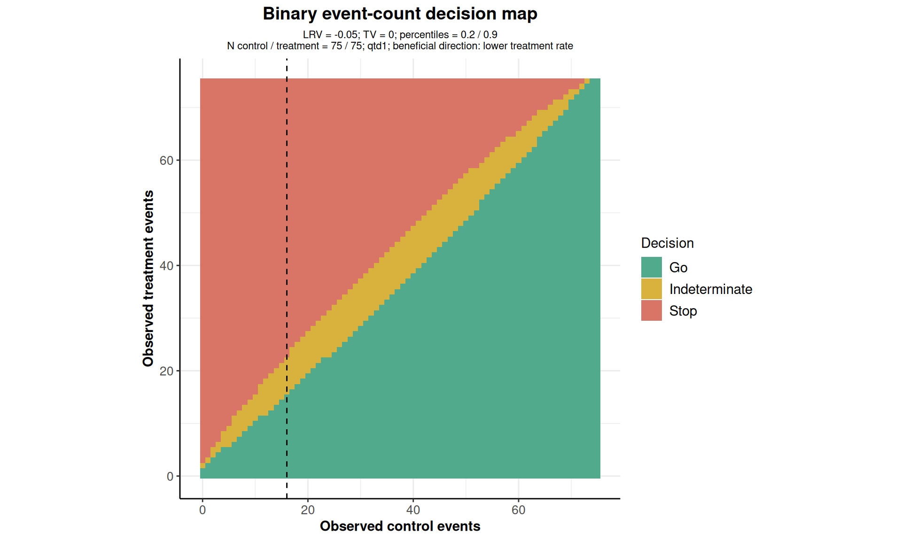

QTD1 decisions for 75 patients per group. The vertical line marks 16
control events.

Here `numberOfSubjects` is a vector of length two, unlike the OC
constructors’ matrix. `observedControl` adds the vertical line.
Supplying `controlRate` and `treatmentRate` together adds joint binomial
cell probabilities to the plot data without changing the decisions.

``` r

controlSlice <- subset(eventMap$data, eventsControl == 16)
observedRanges <- aggregate(eventsTreatment ~ category, controlSlice, range)
knitr::kable(data.frame(
    Decision = observedRanges$category,
    Minimum = observedRanges$eventsTreatment[, 1],
    Maximum = observedRanges$eventsTreatment[, 2]
))
```

| Decision      | Minimum | Maximum |
|:--------------|--------:|--------:|
| Go            |       0 |      15 |
| Indeterminate |      16 |      22 |
| Stop          |      23 |      75 |

``` r

aggregate(cellProbability ~ category, eventMap$data, sum)
```

           category cellProbability
    1            Go      0.84845594
    2 Indeterminate      0.13835067
    3          Stop      0.01319339

Aggregated cell probabilities are unconditional OC probabilities at the
supplied true rates. The count ranges condition on the observed control
count and should not be interpreted as those unconditional
probabilities.

## Continuous Endpoints: Means

The continuous-endpoint example concerns AFQ056[^2] and specifies **MAD
= 2.9**, **TD = 4**, a **50th-percentile lower bound**, and an
**80th-percentile upper bound**.

``` r

meansRule <- getDesignQuantitative(
    targetValue = 4,
    lowerReferenceValue = 2.9,
    lowerPercentile = 0.5,
    upperPercentile = 0.8
)
summary(meansRule)
```

**Quantitative trial design (decision rule)**

Fixed quantitative trial decision rule.

- *Target value*: 4.000
- *Lower reference value*: 2.900
- *Upper percentile*: 0.8000
- *Lower percentile*: 0.5000

For the following calculations, we assume a common **standard deviation
of 6**, mean differences from **0 to 6 in steps of 0.1**, and
sample-size pairs **(25, 25), (50, 50), (75, 75), (25, 50), (50, 100),
(75, 150)**. These assumptions are illustrative.

``` r

planningSizes <- matrix(
    c(25, 25, 50, 50, 75, 75, 25, 50, 50, 100, 75, 150),
    ncol = 2,
    byrow = TRUE,
    dimnames = list(NULL, c("control", "treatment"))
)
meansOC <- getOperatingCharcteristicsMeans(
    design = meansRule,
    numberOfSubjects = planningSizes,
    normalApproximation = TRUE,
    groups = 2,
    alternative = seq(0, 6, by = 0.1),
    stDev = 6
)
```

Argument \| Meaning and supported options \| \|:–\|:–\| \| `design` \|
Quantitative

decision rule \| \| `numberOfSubjects` \| Positive integer matrix, one
scenario per row, columns control then treatment \| \|
`normalApproximation` \| Must be `TRUE` in the current implementation \|
\| `groups` \| Must be `2` in the current implementation \| \|
`alternative` \| Vector of true mean differences, treatment minus
control; default `seq(0, 1, 0.2)` \| \| `stDev` \| Positive common
within-group standard deviation; default `1` \| \| `...` \| Reserved
additional arguments; no further QTD calculation options are used here
\|

The sampling standard error is $`s = \sigma\sqrt{1/n_C + 1/n_T}`$. The
normal sampling distribution of the estimated difference gives the six
decision probabilities analytically. This calculation uses a specified
common standard deviation rather than a t-distribution. Means has no
`directionUpper` argument: formulate the endpoint so that larger
differences represent greater benefit. At the lower percentile 0.5,
$`\Phi^{-1}(0.5)=0`$ and $`L=\widehat\theta`$.

## Printing, Summarizing, and Accessing Results

[`print()`](https://rdrr.io/r/base/print.html) distinguishes
user-defined, derived, and default parameters and displays the
long-format probability table. The compact five-scenario object makes
this output manageable.

``` r

print(ratesScenarios)
```

**Parameters and output of operating-characteristics for comparing
rates**

**User defined parameters**

- *Number of subjects \[1\]*: 75, 75
- *Number of subjects \[2\]*: 75, 150
- *Assumed treatment rate*: 0.100, 0.150, 0.175, 0.200, 0.250
- *Assumed control rate*: 0.150
- *Direction upper*: FALSE

**Derived from user defined parameters**

- *Alternatives*: 0.050, 0.000, -0.025, -0.050, -0.100

**Default parameters**

- *Treatment groups*: 2
- *Interval method*: qtd1

**Output**

|  | Category | Probability | Number of subjects (control) | Number of subjects (treatment) | Alternatives | Assumed treatment rate | Assumed control rate |
|----|----|----|----|----|----|----|----|
| 1 | Go (Fixed) | 5.352327e-01 | 75 | 75 | 0.050 | 0.100 | 0.15 |
| 2 | Go (Fixed) | 2.037757e-01 | 75 | 75 | 0.000 | 0.150 | 0.15 |
| 3 | Go (Fixed) | 1.067077e-01 | 75 | 75 | -0.025 | 0.175 | 0.15 |
| 4 | Go (Fixed) | 5.023338e-02 | 75 | 75 | -0.050 | 0.200 | 0.15 |
| 5 | Go (Fixed) | 8.310520e-03 | 75 | 75 | -0.100 | 0.250 | 0.15 |
| 6 | Go | 3.132233e-01 | 75 | 75 | 0.050 | 0.100 | 0.15 |
| 7 | Go | 3.043533e-01 | 75 | 75 | 0.000 | 0.150 | 0.15 |
| 8 | Go | 2.267809e-01 | 75 | 75 | -0.025 | 0.175 | 0.15 |
| 9 | Go | 1.469166e-01 | 75 | 75 | -0.050 | 0.200 | 0.15 |
| 10 | Go | 4.383561e-02 | 75 | 75 | -0.100 | 0.250 | 0.15 |
| 11 | Indeterminate 1 | 1.383506e-01 | 75 | 75 | 0.050 | 0.100 | 0.15 |
| 12 | Indeterminate 1 | 3.913004e-01 | 75 | 75 | 0.000 | 0.150 | 0.15 |
| 13 | Indeterminate 1 | 4.711368e-01 | 75 | 75 | -0.025 | 0.175 | 0.15 |
| 14 | Indeterminate 1 | 4.822145e-01 | 75 | 75 | -0.050 | 0.200 | 0.15 |
| 15 | Indeterminate 1 | 3.433772e-01 | 75 | 75 | -0.100 | 0.250 | 0.15 |
| 16 | Indeterminate 2 | 6.447415e-08 | 75 | 75 | 0.050 | 0.100 | 0.15 |
| 17 | Indeterminate 2 | 2.235870e-09 | 75 | 75 | 0.000 | 0.150 | 0.15 |
| 18 | Indeterminate 2 | 3.442681e-10 | 75 | 75 | -0.025 | 0.175 | 0.15 |
| 19 | Indeterminate 2 | 4.756762e-11 | 75 | 75 | -0.050 | 0.200 | 0.15 |
| 20 | Indeterminate 2 | 6.683973e-13 | 75 | 75 | -0.100 | 0.250 | 0.15 |
| 21 | Stop | 1.232006e-02 | 75 | 75 | 0.050 | 0.100 | 0.15 |
| 22 | Stop | 8.432942e-02 | 75 | 75 | 0.000 | 0.150 | 0.15 |
| 23 | Stop | 1.509382e-01 | 75 | 75 | -0.025 | 0.175 | 0.15 |
| 24 | Stop | 2.224109e-01 | 75 | 75 | -0.050 | 0.200 | 0.15 |
| 25 | Stop | 3.065523e-01 | 75 | 75 | -0.100 | 0.250 | 0.15 |
| 26 | Stop (Fixed) | 8.733303e-04 | 75 | 75 | 0.050 | 0.100 | 0.15 |
| 27 | Stop (Fixed) | 1.624114e-02 | 75 | 75 | 0.000 | 0.150 | 0.15 |
| 28 | Stop (Fixed) | 4.443645e-02 | 75 | 75 | -0.025 | 0.175 | 0.15 |
| 29 | Stop (Fixed) | 9.822453e-02 | 75 | 75 | -0.050 | 0.200 | 0.15 |
| 30 | Stop (Fixed) | 2.979244e-01 | 75 | 75 | -0.100 | 0.250 | 0.15 |
| 31 | Go (Fixed) | 5.947519e-01 | 75 | 150 | 0.050 | 0.100 | 0.15 |
| 32 | Go (Fixed) | 1.987206e-01 | 75 | 150 | 0.000 | 0.150 | 0.15 |
| 33 | Go (Fixed) | 9.205907e-02 | 75 | 150 | -0.025 | 0.175 | 0.15 |
| 34 | Go (Fixed) | 3.674273e-02 | 75 | 150 | -0.050 | 0.200 | 0.15 |
| 35 | Go (Fixed) | 3.869971e-03 | 75 | 150 | -0.100 | 0.250 | 0.15 |
| 36 | Go | 3.201810e-01 | 75 | 150 | 0.050 | 0.100 | 0.15 |
| 37 | Go | 3.720240e-01 | 75 | 150 | 0.000 | 0.150 | 0.15 |
| 38 | Go | 2.716497e-01 | 75 | 150 | -0.025 | 0.175 | 0.15 |
| 39 | Go | 1.625763e-01 | 75 | 150 | -0.050 | 0.200 | 0.15 |
| 40 | Go | 3.558971e-02 | 75 | 150 | -0.100 | 0.250 | 0.15 |
| 41 | Indeterminate 1 | 7.488036e-02 | 75 | 150 | 0.050 | 0.100 | 0.15 |
| 42 | Indeterminate 1 | 3.309465e-01 | 75 | 150 | 0.000 | 0.150 | 0.15 |
| 43 | Indeterminate 1 | 4.311718e-01 | 75 | 150 | -0.025 | 0.175 | 0.15 |
| 44 | Indeterminate 1 | 4.466464e-01 | 75 | 150 | -0.050 | 0.200 | 0.15 |
| 45 | Indeterminate 1 | 2.770091e-01 | 75 | 150 | -0.100 | 0.250 | 0.15 |
| 46 | Indeterminate 2 | 9.126242e-09 | 75 | 150 | 0.050 | 0.100 | 0.15 |
| 47 | Indeterminate 2 | 1.591020e-11 | 75 | 150 | 0.000 | 0.150 | 0.15 |
| 48 | Indeterminate 2 | 4.410220e-13 | 75 | 150 | -0.025 | 0.175 | 0.15 |
| 49 | Indeterminate 2 | 9.714064e-15 | 75 | 150 | -0.050 | 0.200 | 0.15 |
| 50 | Indeterminate 2 | 2.480298e-18 | 75 | 150 | -0.100 | 0.250 | 0.15 |
| 51 | Stop | 9.867110e-03 | 75 | 150 | 0.050 | 0.100 | 0.15 |
| 52 | Stop | 8.685674e-02 | 75 | 150 | 0.000 | 0.150 | 0.15 |
| 53 | Stop | 1.672263e-01 | 75 | 150 | -0.025 | 0.175 | 0.15 |
| 54 | Stop | 2.579502e-01 | 75 | 150 | -0.050 | 0.200 | 0.15 |
| 55 | Stop | 3.414298e-01 | 75 | 150 | -0.100 | 0.250 | 0.15 |
| 56 | Stop (Fixed) | 3.196266e-04 | 75 | 150 | 0.050 | 0.100 | 0.15 |
| 57 | Stop (Fixed) | 1.145223e-02 | 75 | 150 | 0.000 | 0.150 | 0.15 |
| 58 | Stop (Fixed) | 3.789310e-02 | 75 | 150 | -0.025 | 0.175 | 0.15 |
| 59 | Stop (Fixed) | 9.608442e-02 | 75 | 150 | -0.050 | 0.200 | 0.15 |
| 60 | Stop (Fixed) | 3.421014e-01 | 75 | 150 | -0.100 | 0.250 | 0.15 |

[`summary()`](https://rdrr.io/r/base/summary.html) gives the rule and
assumptions, followed by one table per sample-size scenario, with one
row per input effect and six probability columns. Rates tables include
treatment probability and beneficial risk difference.

``` r

meansScenarios <- getOperatingCharcteristicsMeans(
    design = meansRule,
    numberOfSubjects = demoSizes,
    alternative = c(0, 2.9, 4, 6),
    stDev = 6
)
summary(meansScenarios, digits = 4)
```

**Operating-characteristics for comparing means**

**Decision rule**

- *Target value*: 4.0000
- *Lower reference value*: 2.9000
- *Upper percentile*: 0.80000
- *Lower percentile*: 0.50000

**Assumptions**

- *Normal approximation*: TRUE
- *Treatment groups*: 2
- *Standard deviation*: 6.0000

**Number of subjects (control = 75, treatment = 75)**

|  | Alternatives | Go (Fixed) | Go | Indeterminate 1 | Indeterminate 2 | Stop | Stop (Fixed) |
|----|----|----|----|----|----|----|----|
| 1 | 0 | 0.00002 | 0.00057 | 0 | 0.00094 | 0.01554 | 0.98292 |
| 2 | 2.9000 | 0.13079 | 0.25855 | 0 | 0.11067 | 0.30000 | 0.20000 |
| 3 | 4.0000 | 0.50000 | 0.30000 | 0 | 0.06921 | 0.10604 | 0.02475 |
| 4 | 6.0000 | 0.97939 | 0.01864 | 0 | 0.00119 | 0.00075 | 0.00003 |

**Number of subjects (control = 75, treatment = 150)**

|  | Alternatives | Go (Fixed) | Go | Indeterminate 1 | Indeterminate 2 | Stop | Stop (Fixed) |
|----|----|----|----|----|----|----|----|
| 1 | 0 | \<0.00001 | 0.00005 | 0 | 0.00026 | 0.00468 | 0.99500 |
| 2 | 2.9000 | 0.09743 | 0.22722 | 0 | 0.17535 | 0.30000 | 0.20000 |
| 3 | 4.0000 | 0.50000 | 0.30000 | 0 | 0.10257 | 0.08117 | 0.01626 |
| 4 | 6.0000 | 0.99079 | 0.00852 | 0 | 0.00056 | 0.00013 | \<0.00001 |

`output` selects `"all"` (default), `"title"`, `"overview"`, or
`"body"`. The OC overview contains the rule and assumptions; its body
contains the tables. For a decision rule, the body contains its four
parameters. `digits` controls display precision, following the summary
settings `rpact.summary.digits` and `rpact.summary.digits.probs`,
without changing stored probabilities.

``` r

summary(ratesScenarios, output = "title")
```

**Operating-characteristics for comparing rates**

``` r

summary(ratesScenarios, output = "overview")
```

**Decision rule**

- *Target value*: 0
- *Lower reference value*: -0.050
- *Upper percentile*: 0.9000
- *Lower percentile*: 0.2000

**Assumptions**

- *Treatment groups*: 2
- *Assumed control rate*: 0.1500
- *Direction upper*: FALSE
- *Interval method*: qtd1

``` r

summary(binaryRule, output = "body", digits = 4)
```

- *Target value*: 0
- *Lower reference value*: -0.0500
- *Upper percentile*: 0.90000
- *Lower percentile*: 0.20000

Both the original object and its summary support Markdown for reports.
The second expression embeds the summary tables directly into the
document.

``` r

print(ratesScenarios)
```

``` r

summary(ratesScenarios, digits = 4)
```

**Operating-characteristics for comparing rates**

**Decision rule**

- *Target value*: 0
- *Lower reference value*: -0.0500
- *Upper percentile*: 0.90000
- *Lower percentile*: 0.20000

**Assumptions**

- *Treatment groups*: 2
- *Assumed control rate*: 0.15000
- *Direction upper*: FALSE
- *Interval method*: qtd1

**Number of subjects (control = 75, treatment = 75)**

|  | Assumed treatment rate | Alternatives | Go (Fixed) | Go | Indeterminate 1 | Indeterminate 2 | Stop | Stop (Fixed) |
|----|----|----|----|----|----|----|----|----|
| 1 | 0.10000 | 0.0500 | 0.53523 | 0.31322 | 0.13835 | \<0.00001 | 0.01232 | 0.00087 |
| 2 | 0.15000 | 0.0000 | 0.20378 | 0.30435 | 0.39130 | \<0.00001 | 0.08433 | 0.01624 |
| 3 | 0.17500 | -0.0250 | 0.10671 | 0.22678 | 0.47114 | \<0.00001 | 0.15094 | 0.04444 |
| 4 | 0.20000 | -0.0500 | 0.05023 | 0.14692 | 0.48221 | 0 | 0.22241 | 0.09822 |
| 5 | 0.25000 | -0.1000 | 0.00831 | 0.04384 | 0.34338 | 0 | 0.30655 | 0.29792 |

**Number of subjects (control = 75, treatment = 150)**

|  | Assumed treatment rate | Alternatives | Go (Fixed) | Go | Indeterminate 1 | Indeterminate 2 | Stop | Stop (Fixed) |
|----|----|----|----|----|----|----|----|----|
| 1 | 0.10000 | 0.0500 | 0.59475 | 0.32018 | 0.07488 | \<0.00001 | 0.00987 | 0.00032 |
| 2 | 0.15000 | 0.0000 | 0.19872 | 0.37202 | 0.33095 | 0 | 0.08686 | 0.01145 |
| 3 | 0.17500 | -0.0250 | 0.09206 | 0.27165 | 0.43117 | 0 | 0.16723 | 0.03789 |
| 4 | 0.20000 | -0.0500 | 0.03674 | 0.16258 | 0.44665 | 0 | 0.25795 | 0.09608 |
| 5 | 0.25000 | -0.1000 | 0.00387 | 0.03559 | 0.27701 | 0 | 0.34143 | 0.34210 |

The `probabilities` field is a data frame of unrounded values. Columns
include `category`, `probability`, `nControl`, `nTreatment`, and
`alternative`, plus `stDev` for Means or `pi1` and `pi2` for Rates. Each
scenario contains six category blocks, with effects retained in input
order within each block. Repeated rates and sample-size scenarios are
retained; use all relevant identifiers when filtering. A summary stores
a deep copy, so later changes to the original object do not change an
existing summary.

``` r

head(ratesScenarios$probabilities)
```

        category probability nControl nTreatment alternative   pi1  pi2
    1 Go (Fixed)  0.53523266       75         75       0.050 0.100 0.15
    2 Go (Fixed)  0.20377574       75         75       0.000 0.150 0.15
    3 Go (Fixed)  0.10670767       75         75      -0.025 0.175 0.15
    4 Go (Fixed)  0.05023338       75         75      -0.050 0.200 0.15
    5 Go (Fixed)  0.00831052       75         75      -0.100 0.250 0.15
    6         Go  0.31322328       75         75       0.050 0.100 0.15

``` r

meansScenarios$numberOfSubjects
```

         control treatment
    [1,]      75        75
    [2,]      75       150

## Plots of the Decision Rule

There are three rule plot types.
[`getAvailablePlotTypes()`](https://docs.rpact.org/qtd/reference/getAvailablePlotTypes.md)
supplies numbers or captions. A matching caption can replace the numeric
`type`.

``` r

getAvailablePlotTypes(binaryRule, output = "numcap")
```

    $`1`
    [1] "Decision rule intervals"

    $`2`
    [1] "Normal decision regions"

    $`3`
    [1] "Binary event-count decision map"

### Type 1: Decision rule intervals

Without supplied data, type 1 creates illustrative intervals with
varying standard errors to show all six categories. They are interval
configurations rather than six observed results or a common-sample-size
calculation.

``` r

plot(binaryRule, type = 1, plotCat = 6)
```

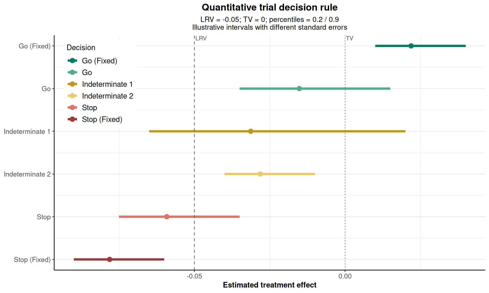

Illustrative interval configurations for the binary decision thresholds.

Supply `estimates` and `standardErrors` together to classify normally
approximated intervals. `labels` supplies one character label per
estimate. This example uses the continuous-endpoint rule’s reference
values and percentiles.

``` r

plot(
    meansRule,
    type = "Decision rule intervals",
    estimates = c(2.4, 3.0, 3.6, 4.5),
    standardErrors = c(0.5, 0.8, 0.6, 0.5),
    labels = c("Kestrel A", "Kestrel B", "Kestrel C", "Kestrel D"),
    plotCat = 3
)
```

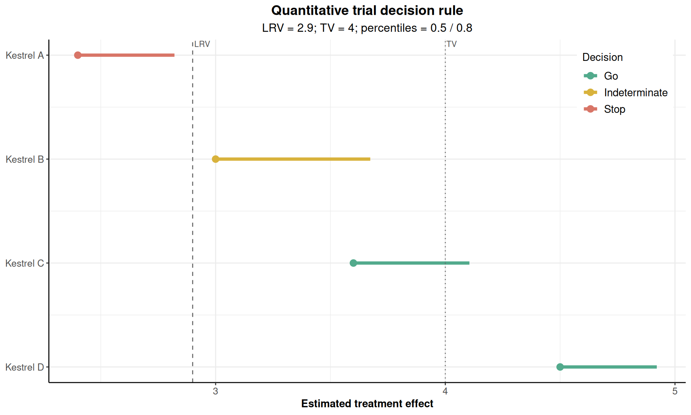

Hypothetical continuous-endpoint results under the AFQ056 example’s
rule.

### Type 2: Normal decision regions

This plot shows decisions against the **observed effect estimate** and
**standard error**, rather than the true effects used in OC plots.
`effectRange` and `standardErrorRange` are increasing pairs. `gridSize`
is the number of evaluated values on each axis (2 to 1000, default 200).
Optional estimates and standard errors overlay points.

``` r

plot(
    meansRule,
    type = 2,
    effectRange = c(0, 6),
    standardErrorRange = c(0, 2),
    gridSize = 200,
    estimates = c(3.0, 4.5),
    standardErrors = c(0.8, 0.5),
    plotCat = 6
)
```

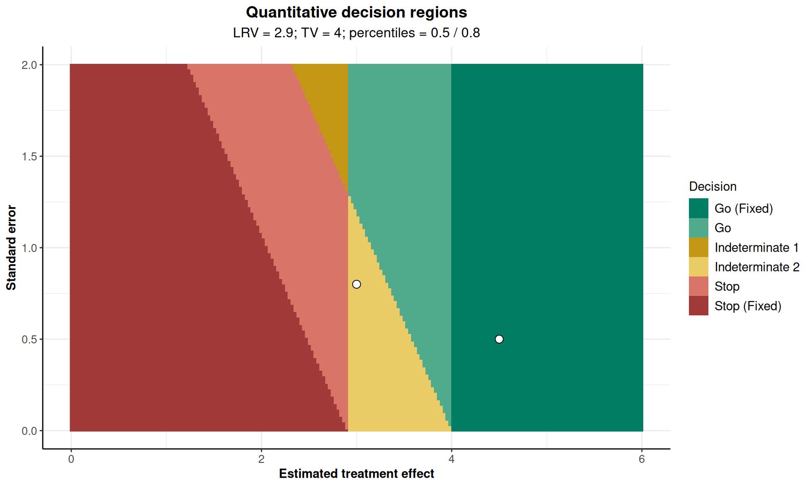

Decision regions for observed mean differences and standard errors.

### Type 3: Binary event-count maps and interval methods

The Kestrel event-count map above illustrates type 3. Four interval
methods are supported by both this plot and the Rates constructor:

| `intervalMethod` | Construction |
|:---|:---|
| `"qtd1"` | Original QTD1 approximation using Wilson score limits rounded to four decimal places in its variance construction |
| `"farringtonManning"` | Risk-difference score-test inversion using constrained maximum-likelihood variance |
| `"miettinenNurminen"` | Score inversion with variance correction $`N/(N-1)`$, where $`N=n_C+n_T`$ |
| `"newcombe"` | Square-and-add combination of unrounded Wilson limits without continuity correction |

QTD1 requires `lowerPercentile <= 0.5 <= upperPercentile`. The other
methods allow ordered percentiles anywhere in $`(0,1)`$, including both
on the same side of 0.5. They use the lower-tail construction below 0.5,
the upper-tail construction above 0.5, and the observed difference at
0.5. See the methodological references below.

This comparison uses additional illustrative sample sizes of 25 per
group to keep calculation of all four maps economical.

``` r

intervalMethods <- c("qtd1", "farringtonManning", "miettinenNurminen", "newcombe")
methodPlots <- lapply(intervalMethods, function(method) {
    return(plot(binaryRule, type = 3, numberOfSubjects = c(25, 25),
        directionUpper = FALSE, intervalMethod = method, plotCat = 6))
})
combinedMap <- methodPlots[[1]]
combinedMap$data <- do.call(rbind, lapply(methodPlots, function(p) {
    return(p$data)
}))
combinedMap$data$intervalMethod <- factor(combinedMap$data$intervalMethod, levels = intervalMethods)
combinedMap + facet_wrap(~intervalMethod, ncol = 2) +
    labs(subtitle = "LRV = -0.05; TV = 0; percentiles = 0.2 / 0.9; C/T = 25/25; lower treatment rates are beneficial")
```

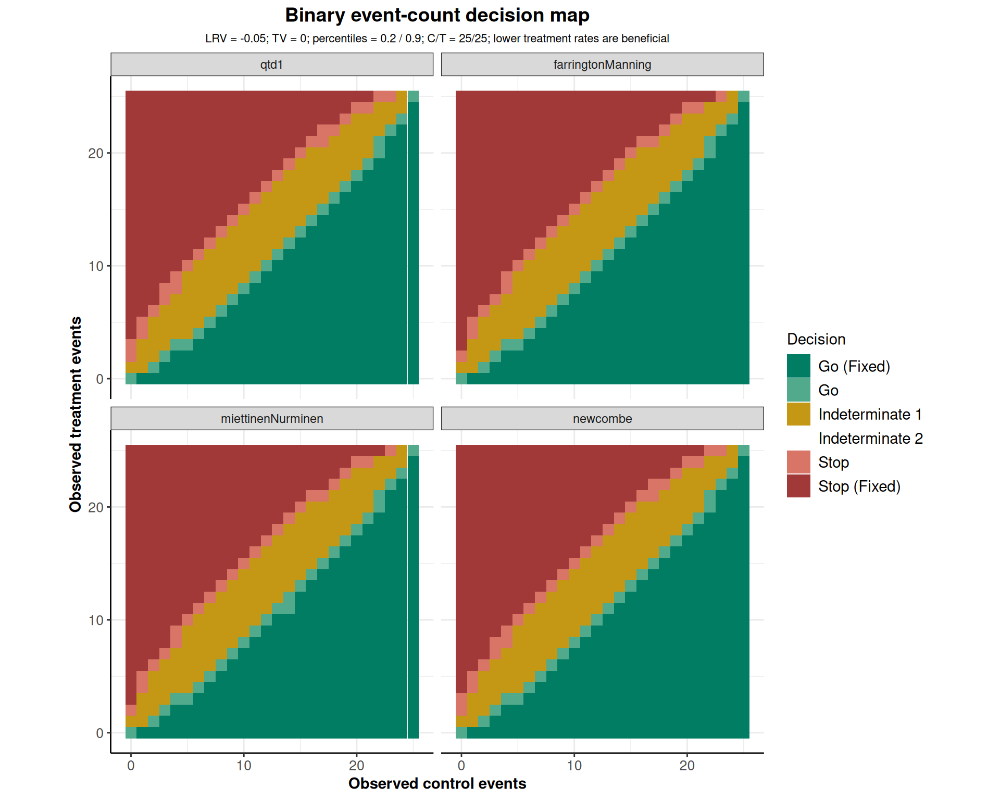

All four interval constructions for 25 patients per group.

Maps contain at most one million cells, including zero-event rows and
columns. Interval methods can classify boundary count pairs differently
and change the OC probabilities. To use another method throughout an OC
analysis, specify it in the constructor:

``` r

scoreRates <- getOperatingCharcteristicsRates(
    design = binaryRule,
    numberOfSubjects = matrix(c(25, 25), ncol = 2),
    pi1 = c(0.10, 0.15, 0.20),
    pi2 = 0.15,
    directionUpper = FALSE,
    intervalMethod = "miettinenNurminen"
)
summary(scoreRates)
```

**Operating-characteristics for comparing rates**

**Decision rule**

- *Target value*: 0
- *Lower reference value*: -0.050
- *Upper percentile*: 0.9000
- *Lower percentile*: 0.2000

**Assumptions**

- *Treatment groups*: 2
- *Assumed control rate*: 0.1500
- *Direction upper*: FALSE
- *Interval method*: miettinenNurminen

**Number of subjects (control = 25, treatment = 25)**

|  | Assumed treatment rate | Alternatives | Go (Fixed) | Go | Indeterminate 1 | Indeterminate 2 | Stop | Stop (Fixed) |
|----|----|----|----|----|----|----|----|----|
| 1 | 0.1000 | 0.050 | 0.4081 | 0.1903 | 0.3632 | 0 | 0.0259 | 0.0125 |
| 2 | 0.1500 | 0.000 | 0.2131 | 0.1555 | 0.5289 | 0 | 0.0602 | 0.0423 |
| 3 | 0.2000 | -0.050 | 0.1003 | 0.0986 | 0.5906 | 0 | 0.1022 | 0.1083 |

``` r

higherIsBetter <- getOperatingCharcteristicsRates(
    design = getDesignQuantitative(targetValue = 0.10, lowerReferenceValue = 0),
    numberOfSubjects = matrix(c(25, 25), ncol = 2),
    pi1 = c(0.15, 0.25, 0.35),
    pi2 = 0.15,
    directionUpper = TRUE,
    intervalMethod = "newcombe"
)
summary(higherIsBetter)
```

**Operating-characteristics for comparing rates**

**Decision rule**

- *Target value*: 0.100
- *Lower reference value*: 0
- *Upper percentile*: 0.9000
- *Lower percentile*: 0.2000

**Assumptions**

- *Treatment groups*: 2
- *Assumed control rate*: 0.1500
- *Direction upper*: TRUE
- *Interval method*: newcombe

**Number of subjects (control = 25, treatment = 25)**

|  | Assumed treatment rate | Alternatives | Go (Fixed) | Go | Indeterminate 1 | Indeterminate 2 | Stop | Stop (Fixed) |
|----|----|----|----|----|----|----|----|----|
| 1 | 0.1500 | 0 | 0.0386 | 0.1745 | 0.4126 | 0 | 0.2718 | 0.1025 |
| 2 | 0.2500 | 0.100 | 0.2135 | 0.3103 | 0.3799 | 0 | 0.0803 | 0.0160 |
| 3 | 0.3500 | 0.200 | 0.4988 | 0.3058 | 0.1789 | 0 | 0.0149 | 0.0017 |

The second example illustrates a beneficial response rather than a
harmful event. Its reference values concern `pi1 - pi2`.

## Plots of Operating Characteristics

All six OC plot types support both endpoints. Their numbers refer to the
OC object rather than the decision-rule object.

``` r

getAvailablePlotTypes(meansOC, output = "numcap")
```

    $`1`
    [1] "Operating characteristics"

    $`2`
    [1] "Stacked decision probabilities"

    $`3`
    [1] "Decision probabilities by sample size"

    $`4`
    [1] "Selected effect scenarios"

    $`5`
    [1] "Sensitivity of decision probabilities"

    $`6`
    [1] "Desired and observed decisions"

``` r

getAvailablePlotTypes(ratesOC, output = "caption")
```

    [1] "Operating characteristics"             "Stacked decision probabilities"
    [3] "Decision probabilities by sample size" "Selected effect scenarios"
    [5] "Sensitivity of decision probabilities" "Desired and observed decisions"       

| `type` | Display | Main additional arguments |
|---:|:---|:---|
| 1 | OC curves | `plotCat`, `alternatives` or `pi1`, `plotPointsEnabled`, `xAxis` |
| 2 | Stacked probabilities | `plotCat`, `alternatives` or `pi1`, `xAxis` |
| 3 | Probabilities versus total sample size | Selected effects, multiple sample sizes |
| 4 | Selected effect scenarios | `alternatives` or `pi1` |
| 5 | Sensitivity heatmap | `sensitivity`, `category`, `contourLevels`, `stDev` or `pi2` |
| 6 | Desired versus observed decisions | `weights`, `desiredDecisions`, selected effects |

`alternatives` selects already calculated effects. For Rates, `pi1`
instead selects treatment rates; supply only one selection argument.
Rates selections through `alternatives` refer to beneficial effects at
the **original** control rate. When `pi2` is varied, the corresponding
treatment rates stay fixed and their risk differences change with the
control rate.

### Type 1: Operating-characteristics curves

The binary plot compares the two sample-size scenarios, with
treatment-rate range 0.10–0.25 and reference rates 0.15 and 0.20
corresponding to TV and LRV.

``` r

plot(ratesOC, type = 1, plotCat = 3, plotPointsEnabled = FALSE,
    main = "Kestrel: binary operating characteristics")
```

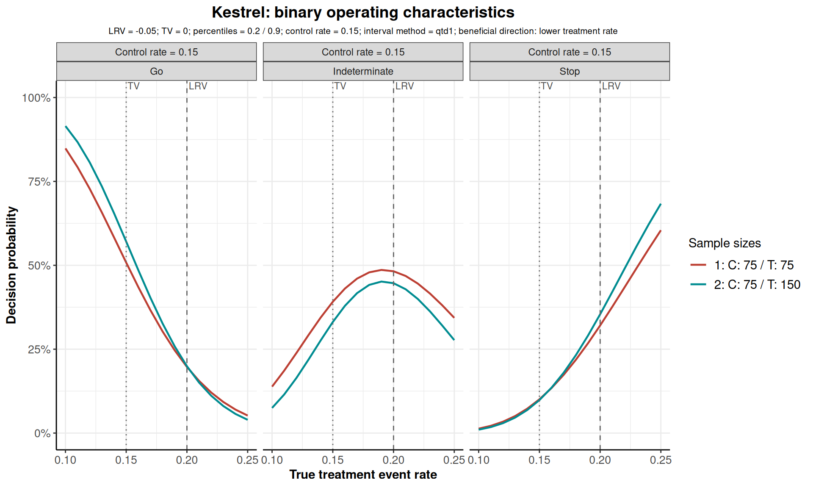

Kestrel OC curves for 75 control versus 75 or 150 treatment patients.

Rates defaults to `xAxis = "treatmentRate"`; `"effect"` shows beneficial
risk difference. Reference lines are transformed separately for each
control-rate panel. Unattainable reference rates outside $`[0,1]`$ are
omitted.

``` r

plot(ratesOC, type = 1, xAxis = "effect", plotCat = 6,
    plotPointsEnabled = FALSE)
```

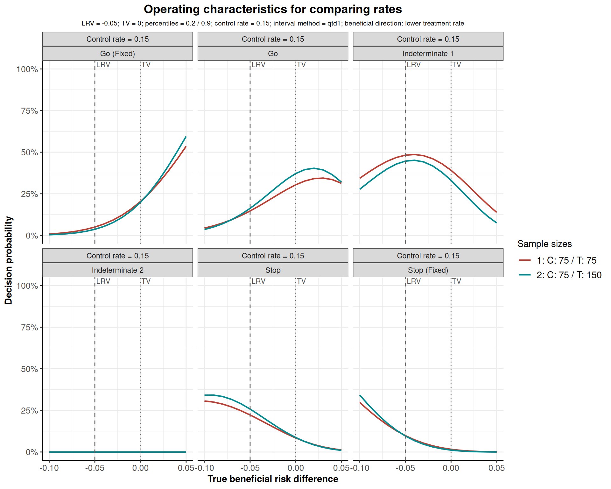

Binary OC curves on the beneficial risk-difference scale, retaining six
categories.

Means uses the true mean difference. By default `plotPointsEnabled = NA`
adds points for grids of at most ten distinct effects. `TRUE` and
`FALSE` override this behavior for OC curves.

``` r

plot(meansOC, type = 1, alternatives = c(0, 2.9, 4, 6), plotPointsEnabled = TRUE)
```

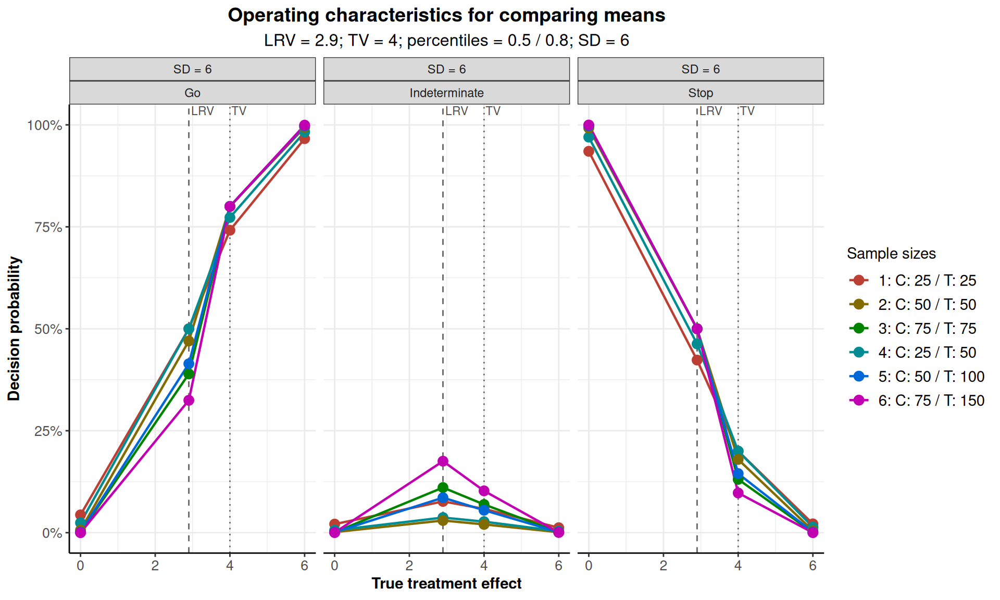

Continuous OC curves at selected true mean differences.

### Type 2: Stacked decision probabilities

Stacked plots show the composition of probabilities for each sample-size
scenario. Areas interpolate linearly between supplied grid points
without calculating additional effects; use a sufficiently dense grid
for a smooth display.

``` r

plot(meansOC, type = 2, plotCat = 3)
```

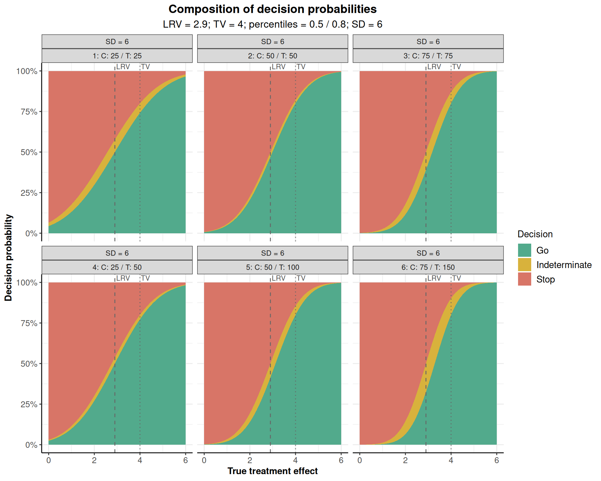

Stacked probabilities for continuous and binary endpoints.

``` r

plot(ratesOC, type = "Stacked decision probabilities", plotCat = 6)
```

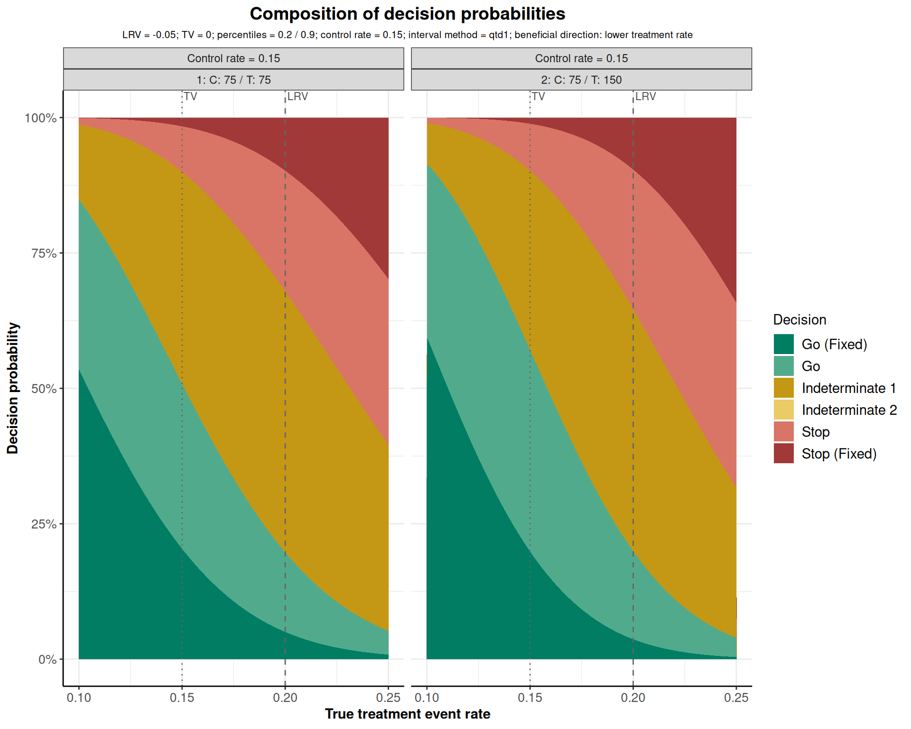

Stacked probabilities for continuous and binary endpoints.

### Type 3: Decision probabilities by sample size

This plot needs multiple total sample sizes. Allocation ratios are
separated so that different treatment-to-control allocations are not
joined into one curve. The Kestrel binary example has only one total N
for each allocation ratio. For meaningful sample-size curves we use the
additional `planningSizes` grid.

``` r

ratesPlanning <- getOperatingCharcteristicsRates(
    design = binaryRule,
    numberOfSubjects = planningSizes,
    pi1 = seq(0.10, 0.25, by = 0.005),
    pi2 = 0.15,
    directionUpper = FALSE
)
plot(meansOC, type = 3, alternatives = c(0, 2.9, 4, 6))
```

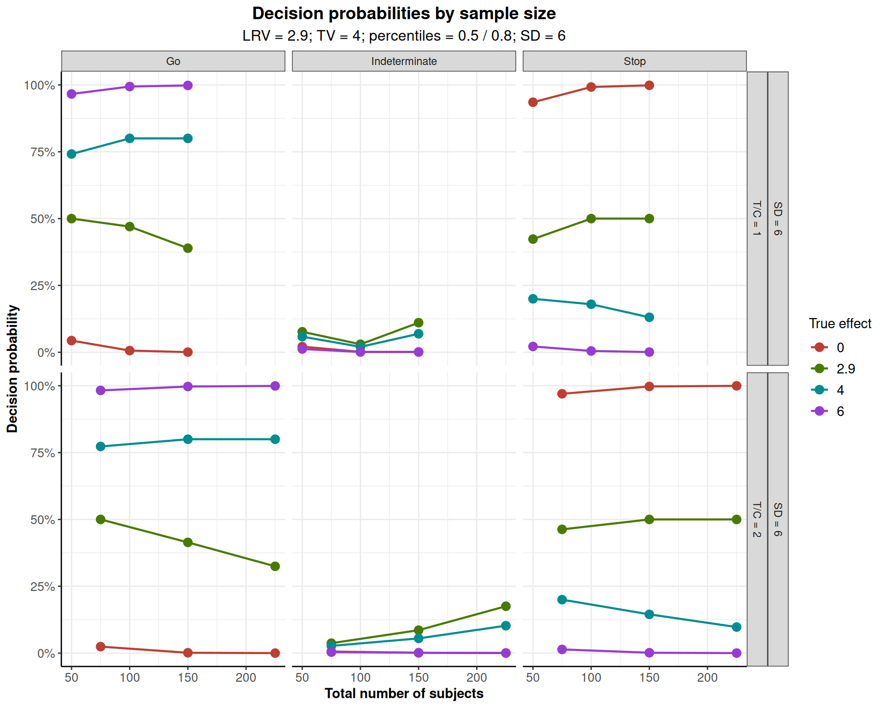

Decision probabilities by sample size with separate allocation ratios.

``` r

plot(ratesPlanning, type = 3, pi1 = c(0.10, 0.15, 0.20))
```

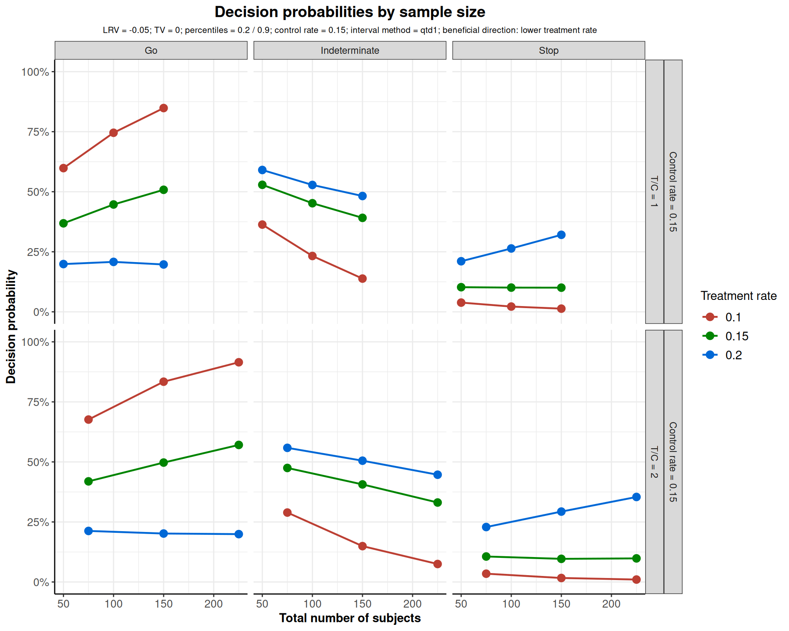

Decision probabilities by sample size with separate allocation ratios.

### Type 4: Selected effect scenarios

This plot compares actual grid points as discrete scenarios without
interpolation. Types 3 and 4 always show points, independently of
`plotPointsEnabled`.

``` r

plot(meansOC, type = 4, alternatives = c(0, 2.9, 4, 6))
```

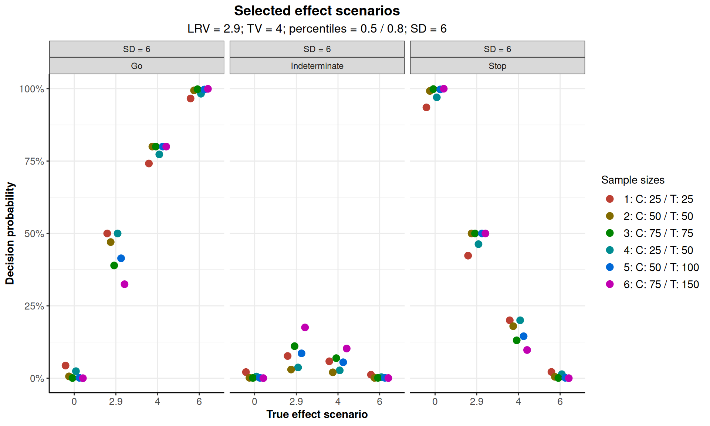

Selected mean differences and the five Kestrel treatment-rate scenarios.

``` r

plot(ratesScenarios, type = 4, pi1 = scenarioRates)
```

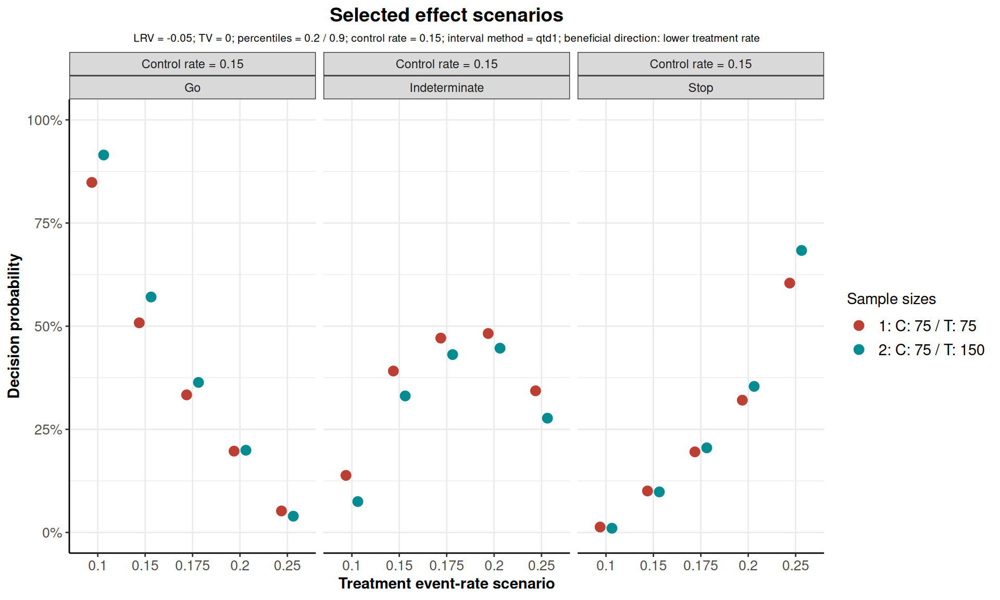

Selected mean differences and the five Kestrel treatment-rate scenarios.

### Type 5: Sensitivity of decision probabilities

Sensitivity plots show one `category`, default `"Go"`. With
`plotCat = 3`, choose Go, Indeterminate, or Stop; with `plotCat = 6`,
use a detailed category name. Data must form a rectangular grid with at
least two coordinates on each axis. Maps use evaluated combinations and
do not extrapolate to missing scenarios.

#### Sample-size sensitivity

`sensitivity = "sampleSize"` is the default. It varies effect or
treatment rate and total sample size, separately by allocation ratio and
endpoint assumption. `contourLevels` optionally supplies probabilities
in $`[0,1]`$ for contours.

``` r

plot(meansOC, type = 5, sensitivity = "sampleSize", category = "Go",
    contourLevels = c(0.2, 0.5, 0.8))
```

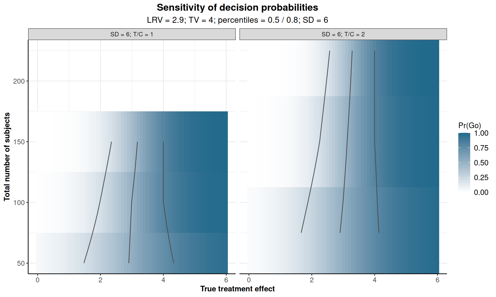

Sensitivity to effect and total sample size, using added planning
scenarios.

``` r

plot(ratesPlanning, type = 5, sensitivity = "sampleSize", category = "Indeterminate")
```

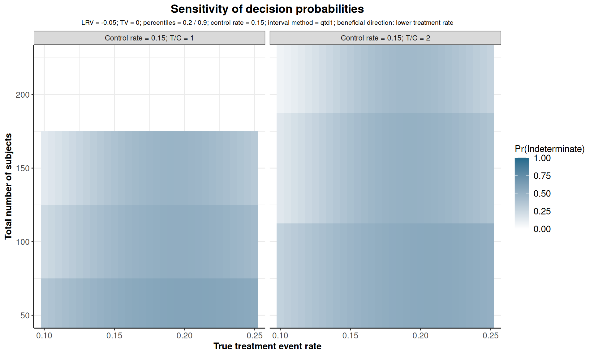

Sensitivity to effect and total sample size, using added planning
scenarios.

#### Standard-deviation sensitivity for Means

A positive `stDev` vector recalculates OC probabilities using the normal
calculation. `sensitivity = "stDev"` places these values on the vertical
axis. `stDev` can also create assumption panels for the other OC types.
Recalculation for plotting does not replace the stored probabilities.

``` r

plot(meansOC, type = 5, sensitivity = "stDev", stDev = seq(4, 8, by = 1),
    category = "Go", contourLevels = c(0.2, 0.5, 0.8))
```

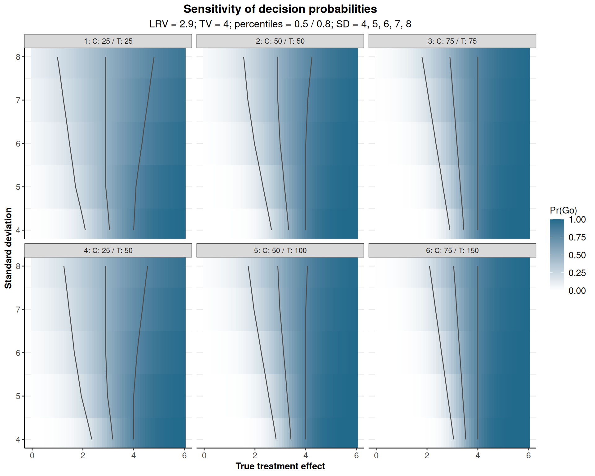

Continuous Go probabilities across standard deviations of 4 to 8.

#### Control-rate sensitivity for Rates

`sensitivity = "pi2"` and a `pi2` vector recalculate probabilities for
different true control rates using the stored interval method and
direction. This map always uses treatment and control rates as axes.
Treatment rates stay fixed. `stDev` applies only to Means and `pi2` only
to Rates.

``` r

plot(ratesOC, type = 5, sensitivity = "pi2", pi2 = seq(0.10, 0.20, by = 0.025),
    category = "Go", contourLevels = c(0.2, 0.5, 0.8))
```

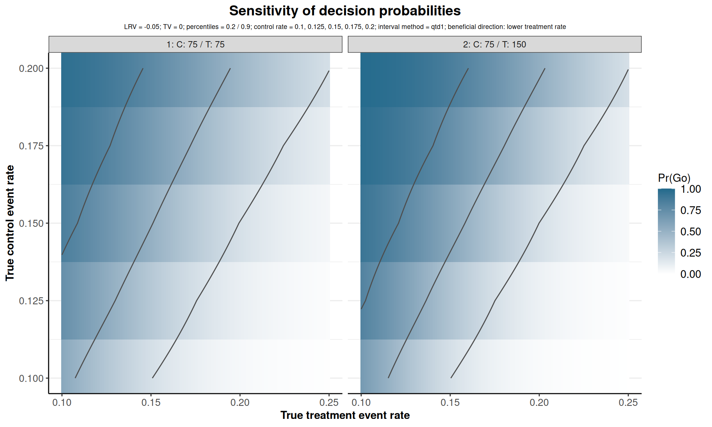

Kestrel Go probabilities at control rates from 0.10 to 0.20.

#### Allocation sensitivity

Allocation maps require one selected effect and a complete grid of
control and treatment sample sizes. The additional grid below varies
both arms independently.

``` r

allocationSizes <- as.matrix(expand.grid(control = c(25, 75), treatment = c(25, 75)))
meansAllocation <- getOperatingCharcteristicsMeans(
    design = meansRule,
    numberOfSubjects = allocationSizes,
    alternative = 4,
    stDev = 6
)
ratesAllocation <- getOperatingCharcteristicsRates(
    design = binaryRule,
    numberOfSubjects = allocationSizes,
    pi1 = 0.15,
    pi2 = 0.15,
    directionUpper = FALSE
)
plot(meansAllocation, type = 5, sensitivity = "allocation", category = "Go")
```

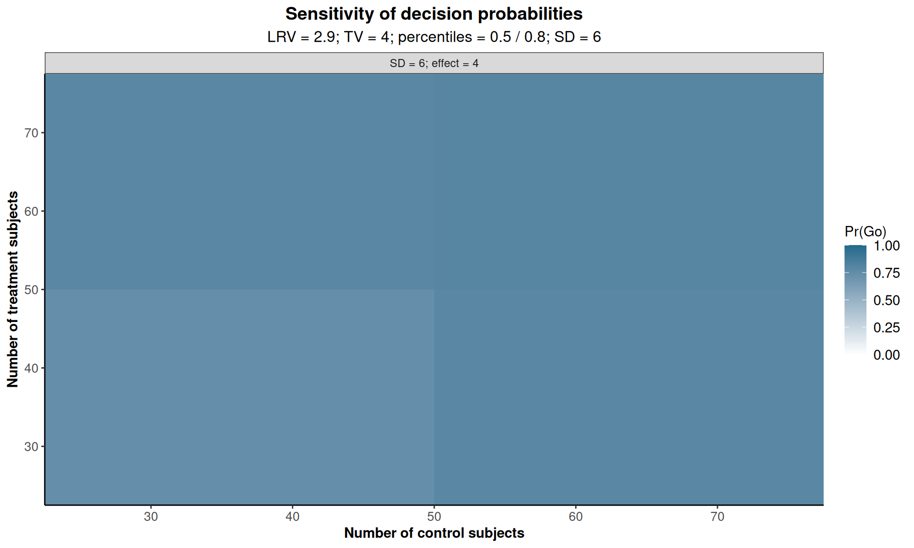

Allocation sensitivity at mean difference 4 and equal binary event rates
0.15.

``` r

plot(ratesAllocation, type = 5, sensitivity = "allocation", category = "Stop")
```

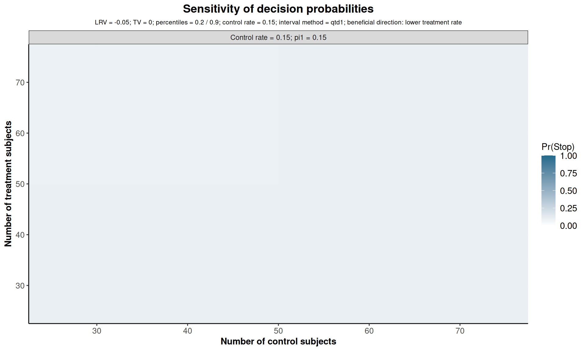

Allocation sensitivity at mean difference 4 and equal binary event rates
0.15.

### Type 6: Desired and observed decisions

This display needs an explicit distribution over selected true-effect
scenarios. Supply one nonnegative entry per effect through `weights`,
summing to one, and one desired decision (`"Go"`, `"Indeterminate"`, or
`"Stop"`) through `desiredDecisions`. Both follow selection order. These
are additional decision-analysis assumptions, not estimates supplied by
the trial.

Each cell is a joint probability: conditional decision probabilities
multiplied by scenario weights and summed over scenarios. Matching
desired and observed decisions count as correct under this definition.
Indeterminate remains separate and is not treated as Stop. These are
neither conventional type-I/type-II error rates nor posterior
probabilities. Each panel reports its probability of a correct decision
under the supplied definition.

``` r

meansPerformance <- plot(
    meansOC,
    type = 6,
    alternatives = c(0, 2.9, 4, 6),
    weights = c(0.25, 0.25, 0.25, 0.25),
    desiredDecisions = c("Stop", "Indeterminate", "Go", "Go")
)
meansPerformance
```

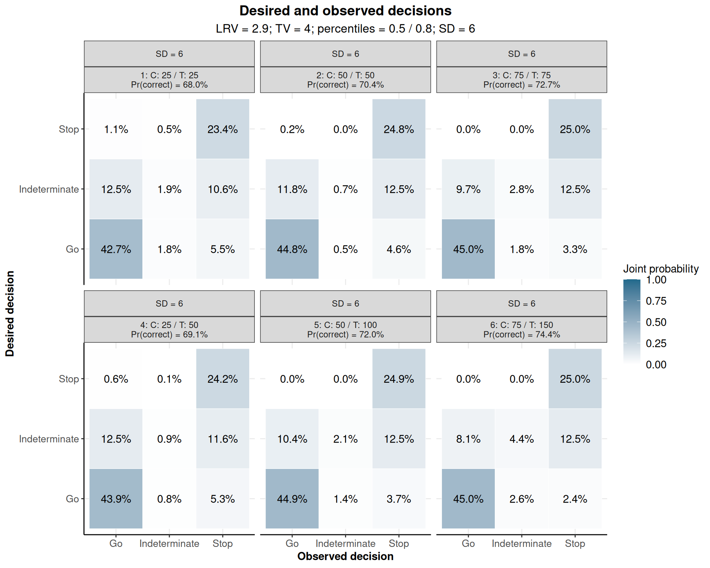

Desired and observed decisions under explicitly chosen effect
distributions.

``` r

ratesPerformance <- plot(
    ratesScenarios,
    type = 6,
    pi1 = scenarioRates,
    weights = c(0.2, 0.2, 0.2, 0.2, 0.2),
    desiredDecisions = c("Go", "Go", "Indeterminate", "Stop", "Stop")
)
ratesPerformance
```

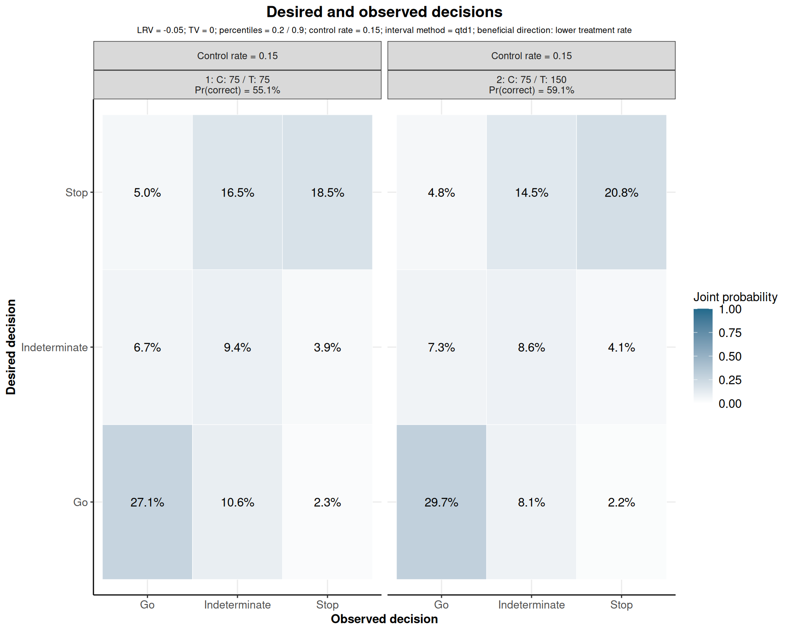

Desired and observed decisions under explicitly chosen effect
distributions.

The data include `desiredDecision`, `observedDecision`, and `correct`.
The `qtdEffectDistribution` attribute records the exact effect
distribution and desired decisions. For Rates it identifies scenarios by
`pi1`. If several `pi2` values are supplied, the same distribution over
treatment rates and desired decisions applies separately to each
control-rate panel.

``` r

attr(ratesPerformance, "qtdEffectDistribution")
```

        pi1 weight desiredDecision
    1 0.100    0.2              Go
    2 0.150    0.2              Go
    3 0.175    0.2   Indeterminate
    4 0.200    0.2            Stop
    5 0.250    0.2            Stop

``` r

head(ratesPerformance$data[c("desiredDecision", "observedDecision", "probability", "correct")])
```

      desiredDecision observedDecision probability correct
    1              Go               Go  0.27131700    TRUE
    2   Indeterminate               Go  0.06669772   FALSE
    3            Stop               Go  0.04985922   FALSE
    4              Go    Indeterminate  0.10593021   FALSE
    5   Indeterminate    Indeterminate  0.09422735    TRUE
    6            Stop    Indeterminate  0.16511834   FALSE

## Plot Appearance, Source Data, and Exports

All QTD plots accept `main`, `xlab`, `ylab`, `palette`,
`legendPosition`, `plotSettings`, and `showSource`. With
`palette = NULL`, decision categories use semantic colors and
sample-size curves use the rpact hue palette. Sensitivity and
performance use a continuous probability scale. The default legend
position is `"auto"`; standard positions such as `"bottom"` and `"none"`
are also supported.

``` r

kestrelPlot <- plot(
    ratesOC,
    type = 1,
    plotCat = 3,
    plotPointsEnabled = FALSE,
    main = "Kestrel: probability of each development decision",
    xlab = "True composite efficacy failure probability on treatment",
    ylab = "Probability",
    palette = "Set1",
    legendPosition = "bottom",
    plotSettings = getPlotSettings(
        lineSize = 1,
        pointSize = 2,
        mainTitleFontSize = 14,
        axesTextFontSize = 10,
        legendFontSize = 10
    )
)
kestrelPlot
```

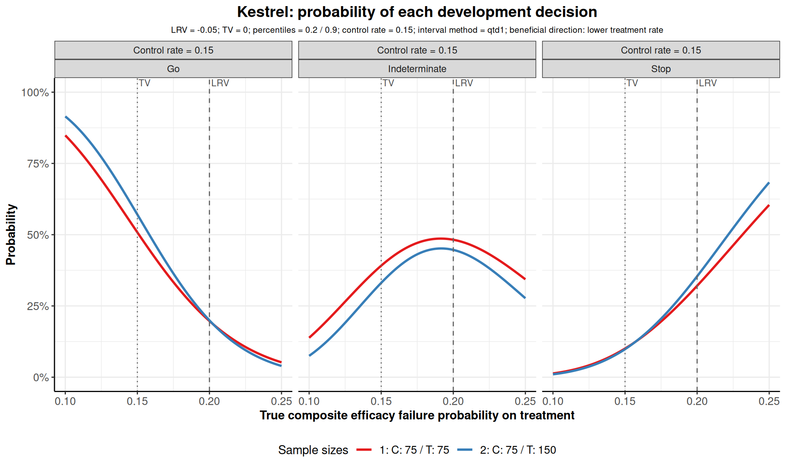

Kestrel OC curves customized with the shared rpact plot settings.

Results are ggplot objects supporting additional ggplot2 layers and
themes. `data` contains the unrounded plot data. `showSource = TRUE`
also prints them; a compact scenario object keeps this output
manageable.

``` r

sourcePlot <- plot(ratesScenarios, type = 4, showSource = TRUE)
```

    Source data of the QTD plot:
            category scenario effectIndex nControl nTreatment alternative  pi2   pi1 probability     sampleSize
    1             Go        1           1       75         75       0.050 0.15 0.100  0.84845594  C: 75 / T: 75
    2  Indeterminate        1           1       75         75       0.050 0.15 0.100  0.13835067  C: 75 / T: 75
    3           Stop        1           1       75         75       0.050 0.15 0.100  0.01319339  C: 75 / T: 75
    4             Go        2           1       75        150       0.050 0.15 0.100  0.91493290 C: 75 / T: 150
    5  Indeterminate        2           1       75        150       0.050 0.15 0.100  0.07488037 C: 75 / T: 150
    6           Stop        2           1       75        150       0.050 0.15 0.100  0.01018674 C: 75 / T: 150
    7             Go        1           2       75         75       0.000 0.15 0.150  0.50812904  C: 75 / T: 75
    8  Indeterminate        1           2       75         75       0.000 0.15 0.150  0.39130040  C: 75 / T: 75
    9           Stop        1           2       75         75       0.000 0.15 0.150  0.10057056  C: 75 / T: 75
    10            Go        2           2       75        150       0.000 0.15 0.150  0.57074458 C: 75 / T: 150
    11 Indeterminate        2           2       75        150       0.000 0.15 0.150  0.33094646 C: 75 / T: 150
    12          Stop        2           2       75        150       0.000 0.15 0.150  0.09830897 C: 75 / T: 150
    13            Go        1           3       75         75      -0.025 0.15 0.175  0.33348862  C: 75 / T: 75
    14 Indeterminate        1           3       75         75      -0.025 0.15 0.175  0.47113675  C: 75 / T: 75
    15          Stop        1           3       75         75      -0.025 0.15 0.175  0.19537463  C: 75 / T: 75
    16            Go        2           3       75        150      -0.025 0.15 0.175  0.36370879 C: 75 / T: 150
    17 Indeterminate        2           3       75        150      -0.025 0.15 0.175  0.43117184 C: 75 / T: 150
    18          Stop        2           3       75        150      -0.025 0.15 0.175  0.20511938 C: 75 / T: 150
    19            Go        1           4       75         75      -0.050 0.15 0.200  0.19714998  C: 75 / T: 75
    20 Indeterminate        1           4       75         75      -0.050 0.15 0.200  0.48221454  C: 75 / T: 75
    21          Stop        1           4       75         75      -0.050 0.15 0.200  0.32063548  C: 75 / T: 75
    22            Go        2           4       75        150      -0.050 0.15 0.200  0.19931900 C: 75 / T: 150
    23 Indeterminate        2           4       75        150      -0.050 0.15 0.200  0.44664640 C: 75 / T: 150
    24          Stop        2           4       75        150      -0.050 0.15 0.200  0.35403460 C: 75 / T: 150
    25            Go        1           5       75         75      -0.100 0.15 0.250  0.05214613  C: 75 / T: 75
    26 Indeterminate        1           5       75         75      -0.100 0.15 0.250  0.34337718  C: 75 / T: 75
    27          Stop        1           5       75         75      -0.100 0.15 0.250  0.60447670  C: 75 / T: 75
    28            Go        2           5       75        150      -0.100 0.15 0.250  0.03945968 C: 75 / T: 150
    29 Indeterminate        2           5       75        150      -0.100 0.15 0.250  0.27700912 C: 75 / T: 150
    30          Stop        2           5       75        150      -0.100 0.15 0.250  0.68353120 C: 75 / T: 150
           scenarioLabel totalSubjects allocationRatio effectLabel
    1   1: C: 75 / T: 75           150               1         0.1
    2   1: C: 75 / T: 75           150               1         0.1
    3   1: C: 75 / T: 75           150               1         0.1
    4  2: C: 75 / T: 150           225               2         0.1
    5  2: C: 75 / T: 150           225               2         0.1
    6  2: C: 75 / T: 150           225               2         0.1
    7   1: C: 75 / T: 75           150               1        0.15
    8   1: C: 75 / T: 75           150               1        0.15
    9   1: C: 75 / T: 75           150               1        0.15
    10 2: C: 75 / T: 150           225               2        0.15
    11 2: C: 75 / T: 150           225               2        0.15
    12 2: C: 75 / T: 150           225               2        0.15
    13  1: C: 75 / T: 75           150               1       0.175
    14  1: C: 75 / T: 75           150               1       0.175
    15  1: C: 75 / T: 75           150               1       0.175
    16 2: C: 75 / T: 150           225               2       0.175
    17 2: C: 75 / T: 150           225               2       0.175
    18 2: C: 75 / T: 150           225               2       0.175
    19  1: C: 75 / T: 75           150               1         0.2
    20  1: C: 75 / T: 75           150               1         0.2
    21  1: C: 75 / T: 75           150               1         0.2
    22 2: C: 75 / T: 150           225               2         0.2
    23 2: C: 75 / T: 150           225               2         0.2
    24 2: C: 75 / T: 150           225               2         0.2
    25  1: C: 75 / T: 75           150               1        0.25
    26  1: C: 75 / T: 75           150               1        0.25
    27  1: C: 75 / T: 75           150               1        0.25
    28 2: C: 75 / T: 150           225               2        0.25
    29 2: C: 75 / T: 150           225               2        0.25
    30 2: C: 75 / T: 150           225               2        0.25

``` r

head(sourcePlot$data)
```

           category scenario effectIndex nControl nTreatment alternative  pi2 pi1 probability     sampleSize
    1            Go        1           1       75         75        0.05 0.15 0.1  0.84845594  C: 75 / T: 75
    2 Indeterminate        1           1       75         75        0.05 0.15 0.1  0.13835067  C: 75 / T: 75
    3          Stop        1           1       75         75        0.05 0.15 0.1  0.01319339  C: 75 / T: 75
    4            Go        2           1       75        150        0.05 0.15 0.1  0.91493290 C: 75 / T: 150
    5 Indeterminate        2           1       75        150        0.05 0.15 0.1  0.07488037 C: 75 / T: 150
    6          Stop        2           1       75        150        0.05 0.15 0.1  0.01018674 C: 75 / T: 150
          scenarioLabel totalSubjects allocationRatio effectLabel
    1  1: C: 75 / T: 75           150               1         0.1
    2  1: C: 75 / T: 75           150               1         0.1
    3  1: C: 75 / T: 75           150               1         0.1
    4 2: C: 75 / T: 150           225               2         0.1
    5 2: C: 75 / T: 150           225               2         0.1
    6 2: C: 75 / T: 150           225               2         0.1

Plots can be saved as PNG files, and full probability data and compact
summary tables can be exported as CSV files. The following code
illustrates this workflow with explicit filenames and table contents.
This optional export code is not executed when rendering the vignette.

``` r

ggplot2::ggsave("kestrel_plot.png", kestrelPlot, width = 10, height = 6, dpi = 300)
utils::write.csv(ratesOC$probabilities, "kestrel_data.csv", row.names = FALSE)
utils::write.csv(scenarioTable, "kestrel_table.csv", row.names = FALSE)
writeLines(as.character(print(summary(ratesScenarios), markdown = TRUE)), "kestrel_summary.md")
```

## References

- Farrington, C. P. and Manning, G. (1990). Test statistics and sample
  size formulae for comparative binomial trials with null hypothesis of
  non-zero risk difference or non-unity relative risk. *Statistics in
  Medicine*, 9, 1447–1454.
  [doi:10.1002/sim.4780091208](https://doi.org/10.1002/sim.4780091208).
- Miettinen, O. and Nurminen, M. (1985). Comparative analysis of two
  rates. *Statistics in Medicine*, 4, 213–226.
  [doi:10.1002/sim.4780040211](https://doi.org/10.1002/sim.4780040211).
- Newcombe, R. G. (1998). Interval estimation for the difference between
  independent proportions: comparison of eleven methods. *Statistics in
  Medicine*, 17, 873–890. [Publication
  link](https://doi.org/10.1002/(SICI)1097-0258(19980430)17:8%3C873::AID-SIM779%3E3.0.CO;2-I).
- Armitage, P. (1989). Inference and decision in clinical trials.
  *Journal of Clinical Epidemiology*, 42, 293–299.
- Spiegelhalter, D. J., Abrams, K. R., and Myles, J. P. (2004).
  *Bayesian Approaches to Clinical Trials and Health-Care Evaluation*.
  Wiley, Section 6.3. Background reading on Bayesian decision making;
  the implemented calculations above use frequentist interval
  constructions.

[^1]: AEB071 is the publicly documented code for sotrastaurin. The
    [NCT01064791 study
    record](https://clinicaltrials.gov/study/NCT01064791) and [EU trial
    results record
    2009-015456-14](https://www.clinicaltrialsregister.eu/ctr-search/trial/2009-015456-14/results)
    identify the renal-transplant study, including protocol
    CAEB071A2214. Kestrel names this teaching example, not a new
    compound. The numerical QTD assumptions are illustrative planning
    assumptions, not reported trial results.

[^2]: AFQ056 is the publicly documented code for mavoglurant, an mGluR5
    antagonist; see [the 2014 pharmacological characterization indexed
    in PubMed](https://pubmed.ncbi.nlm.nih.gov/25316499/). The numbers
    2.9, 4, 0.5, and 0.8 are illustrative decision-rule settings, not
    published efficacy results.
